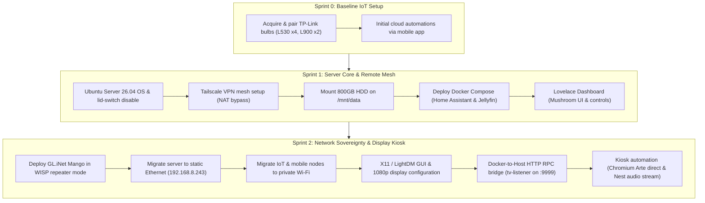

# 🛡️ Repurposed Hardware Homelab

> Documentation and technical implementation of an isolated, self-hosted infrastructure built on a recycled Lenovo laptop and edge routing hardware. Designed to circumvent unmanaged, shared ISP network limitations and establish local automated workflows, kiosk display orchestration, and media control.

---

## 🎯 Project Overview & Constraints

The purpose of this homelab is to establish a reliable, independent compute node using existing consumer hardware, overcoming strict environmental limitations:
- **Zero Administrative Access to ISP Gateway:** Deployed on a shared network without port forwarding, static IP assignment, or local L2 control.
- **Hardware Repurposing:** Running 24/7 server workloads on an aging consumer laptop with storage segregation and lid-closed operation.
- **Edge Network Sovereignty:** Transitioning from reliance on an unmanaged subnet to an autonomous, private WISP/OpenWrt edge router.
- **Hybrid Server/Kiosk Role:** Concurrently serving headless Docker workloads and outputting hardware-accelerated video on an external display via automated event hooks.

---

## 🏗️ Hardware Inventory & Physical Setup

| Device | Model / Role | Operating System / Firmware | Connectivity & Configuration |
| :--- | :--- | :--- | :--- |
| **Central Host Server** | Lenovo G50 | Ubuntu Server 26.04.1 LTS (Kernel 7.0 OEM) | Intel Core i3 / HD 5500, 12GB DDR3 RAM, 256GB SSD (root `/`), 800GB HDD (`/mnt/data`). Direct RJ45 LAN. |
| **Edge Gateway** | GL.iNet GL-MT300N-V2 ("Mango") | OpenWrt-based Firmware | WISP / Client repeater to shared WAN; isolated private subnet `192.168.8.0/24`. |
| **Smart Control Hub** | Apple iPad (2017) | iOS 16 | Dedicated dashboard controller running Mushroom UI and smart alarm interface. |
| **Mobile Endpoint** | OnePlus (CPH2465) | Android / Home Assistant Companion | Remote administration and NFC automation trigger node. |
| **Display Sink** | External Portable Monitor | Native Display | Connected via HDMI to host (1920x1080 @ 60Hz), driven by X11 / LightDM. |
| **Audio & Voice Node** | Google Nest Mini | Google Cast Firmware | Connected via local Wi-Fi (`192.168.8.104`), audio/TTS sink for notifications and alarm logic. |
| **Smart Lighting** | 4x TP-Link Tapo L530, 2x Tapo L900 | TP-Link Smart Home Firmware | Connected via 2.4 GHz local Wi-Fi, polled directly by Home Assistant. |

---

## 🗺️ Engineering Sprints Delivered So Far



---

## 📐 Current Network & Service Topology

```text
               [ Shared Upstream Wi-Fi (Untrusted WAN) ]
                                   │
                                   ▼ (WISP Client Mode)
                [ GL.iNet GL-MT300N-V2 Mango Router ]
                     (Subnet: 192.168.8.0/24)
                                   │
        ┌──────────────────────────┴──────────────────────────┐
        ▼ (Ethernet Cable - enp2s0)                           ▼ (2.4 GHz Wi-Fi)
┌──────────────────────────────────────┐          ┌──────────────────────────┐
│ Lenovo G50 (192.168.8.243)           │          │ Connected Clients & IoT  │
│  - Storage: SSD (OS) + HDD (/mnt/data│          │  - iPad (Dashboard)      │
│  - Ingress: Tailscale (100.80.194.90)│          │  - OnePlus Phone         │
│                                      │          │  - 4x Tapo L530 Bulbs    │
│  Docker Containers:                  │          │  - 2x Tapo L900 Strips   │
│  ├── Home Assistant (Host network)   │          │  - Google Nest Mini      │
│  └── Jellyfin (Port 8096)            │          │    (192.168.8.104)       │
│                                      │          └──────────────────────────┘
│  Host Services & Runtime:            │
│  ├── LightDM / X11 (:0 on HDMI1)     │
│  ├── tv-listener.service (Port 9999) │
│  ├── ffmpeg stream relay (Port 8554) │
│  └── Chromium Kiosk Engine           │
└──────────────────┬───────────────────┘
                   │
                   ▼ (HDMI Video Stream)
          [ External 1080p Monitor ]
```

---

## ⚙️ Core Technical Implementations

### 1. Host Provisioning & Storage Layout
- **ACPI Power Management:** Configured `/etc/systemd/logind.conf` with `HandleLidSwitch=ignore` and applied via `systemctl restart systemd-logind` to prevent sleep states during 24/7 lid-closed operation.
- **Storage Tiering:** 
  - `SSD (256 GB)`: System root (`/`), container runtimes, SQLite state databases.
  - `HDD (800 GB)`: Formatted as `ext4` and persistently mounted at `/mnt/data` via UUID in `/etc/fstab` for Jellyfin library storage (`/mnt/data/medias`).

### 2. Network Perimeter & Mesh Tunneling
- **Edge Routing (OpenWrt):** The GL.iNet Mango establishes a WISP client connection to the unmanaged upstream gateway, serving an isolated `192.168.8.0/24` subnet. The host server binds statically via physical Ethernet (`enp2s0`) to `192.168.8.243`.
- **Mesh Tunneling (Tailscale):** WireGuard-based overlay network binds the host at `100.80.194.90`, enabling secure remote access across the OnePlus phone and iPad without upstream NAT traversal or port forwarding.

### 3. Containerized Service Stack
Containers are declared in `~/serveur/docker-compose.yml`:

```yaml
services:
  homeassistant:
    container_name: homeassistant
    image: "ghcr.io/home-assistant/home-assistant:stable"
    volumes:
      - ~/serveur/homeassistant:/config
      - /etc/localtime:/etc/localtime:ro
    restart: unless-stopped
    network_mode: host
    privileged: true

  jellyfin:
    container_name: jellyfin
    image: jellyfin/jellyfin:latest
    volumes:
      - ~/serveur/jellyfin/config:/config
      - ~/serveur/jellyfin/cache:/cache
      - /mnt/data/medias:/media
    restart: unless-stopped
    ports:
      - "8096:8096"
```

*Architectural trade-off:* `homeassistant` runs with `network_mode: host` and `privileged: true` to enable local mDNS and SSDP discovery for TP-Link Tapo lights and Google Cast endpoints across the subnet.

---

## 📺 Kiosk Pipeline & Audio Orchestration

Because Home Assistant runs isolated inside Docker, it cannot natively bind to the host's X11 server on display `:0`. A host-level RPC pipeline and audio redirection service bridge this boundary.

### 1. Video Display Orchestrator (`/usr/local/bin/tv_arte.sh`)
Controls DPMS power states, screen layout via `xrandr`, and browser runtime:

```bash
#!/bin/bash
export DISPLAY=:0
export XAUTHORITY=/var/run/lightdm/root/:0

case "$1" in
  ouvrir)
    # 1. Ensure X11/LightDM display manager is alive
    if ! pgrep -x "Xorg" > /dev/null; then
      systemctl restart lightdm
      sleep 3
    fi

    # 2. Wake monitor and force 1080p output over HDMI1
    xset -display :0 dpms force on 2>/dev/null
    xrandr --output eDP1 --off --output HDMI1 --mode 1920x1080 --rate 60.00 --primary 2>/dev/null

    # 3. Terminate previous instances
    pkill -9 -f "chrome" 2>/dev/null
    pkill -9 -f "chromium" 2>/dev/null
    pkill -9 -f "epiphany" 2>/dev/null

    # 4. Launch Chromium in native kiosk mode
    runuser -l paulux -c "DISPLAY=:0 chromium-browser --no-first-run --disable-session-crashed-bubble --autoplay-policy=no-user-gesture-required --kiosk 'https://www.arte.tv/fr/direct/' &"
    
    # 5. Start audio loopback to Google Nest Mini
    /usr/local/bin/stream_to_nest.sh start
    ;;

  fermer)
    # Stop audio relay
    /usr/local/bin/stream_to_nest.sh stop

    # Terminate browser instances
    pkill -9 -f "chrome" 2>/dev/null
    pkill -9 -f "chromium" 2>/dev/null
    pkill -9 -f "epiphany" 2>/dev/null

    # Turn off display signal
    xrandr --output HDMI1 --off 2>/dev/null
    xset -display :0 dpms force off 2>/dev/null
    ;;

  toggle)
    if pgrep -f "chromium-browser/chrome" > /dev/null; then
      /usr/local/bin/tv_arte.sh fermer
    else
      /usr/local/bin/tv_arte.sh ouvrir
    fi
    ;;
esac
```

### 2. Audio Bridge to Google Nest Mini (`/usr/local/bin/stream_to_nest.sh`)
Solves headless PulseAudio/PipeWire streaming by tapping the host monitor sink and casting via `catt` (Cast All The Things):

```bash
#!/bin/bash
DEVICE_NAME="Chambre principale"

case "$1" in
  start)
    pkill -f "ffmpeg.*8554" 2>/dev/null
    catt -d "$DEVICE_NAME" stop 2>/dev/null

    # Capture PulseAudio output monitor, transcode to MP3, expose via HTTP
    runuser -l paulux -c "export XDG_RUNTIME_DIR=/run/user/1000; ffmpeg -f pulse -i default.monitor -acodec libmp3lame -ab 128k -f mp3 -listen 1 http://0.0.0.0:8554/stream.mp3 &"
    sleep 1

    # Instruct Google Nest Mini to play the local stream
    catt -d "$DEVICE_NAME" cast "http://192.168.8.243:8554/stream.mp3" &
    ;;

  stop)
    catt -d "$DEVICE_NAME" stop 2>/dev/null
    pkill -9 -f "ffmpeg.*8554" 2>/dev/null
    ;;
esac
```

### 3. Host Command Listener (`/etc/systemd/system/tv-listener.service`)
A systemd unit listening on port `9999` using `ncat` to accept commands from Home Assistant:

```ini
[Unit]
Description=TV Display and Audio Command Listener
After=network.target sound.target

[Service]
Type=simple
ExecStart=/bin/sh -c 'while true; do { echo -ne "HTTP/1.1 200 OK\\r\\nContent-Length: 2\\r\\n\\r\\nOK"; } | ncat -l -p 9999 -c "xargs -n1 /bin/sh -c \'case \$$0 in *ouvrir*) /usr/local/bin/tv_arte.sh ouvrir;; *fermer*) /usr/local/bin/tv_arte.sh fermer;; esac\'"; done'
Restart=always
RestartSec=3

[Install]
WantedBy=multi-user.target
```

### 4. Home Assistant Invocation
Exposed to Home Assistant automations via `shell_command`:

```yaml
shell_command:
  ouvrir_tv_arte: "curl -s http://192.168.8.243:9999/ouvrir"
  fermer_tv_arte: "curl -s http://192.168.8.243:9999/fermer"
```

---

## 🔍 Validation & Operations Runbook

### Service & Interface Checks
```bash
# Verify static Ethernet interface and IP configuration
ip -br addr show enp2s0

# Confirm Tailscale VPN link status
tailscale status

# Check Docker containers
docker ps --format "table {{.Names}}\t{{.Status}}\t{{.Ports}}"
```

### Kiosk & Stream Testing
```bash
# Test manual trigger of TV kiosk
curl http://192.168.8.243:9999/ouvrir

# Inspect local audio stream socket
ss -tulpn | grep 8554

# Test manual shutdown of TV kiosk
curl http://192.168.8.243:9999/fermer
```

---

## 👤 Author
Maintained by **Paulux** as a technical record of self-hosted edge architecture and automated hardware control under restricted network environments.
