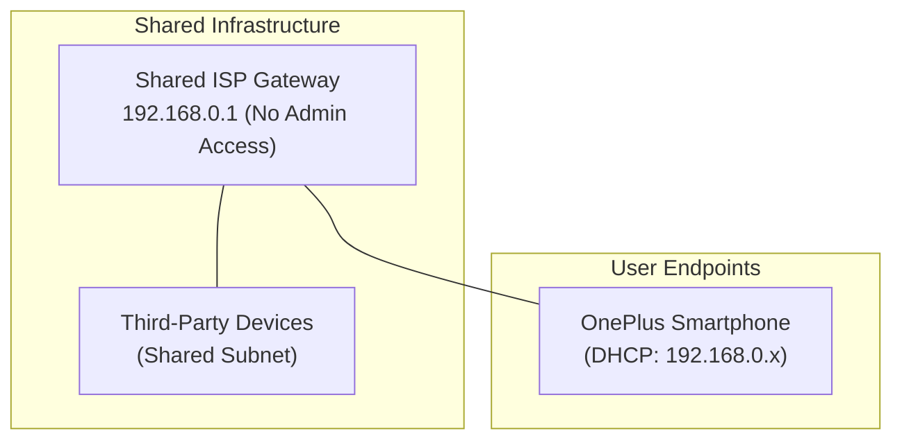
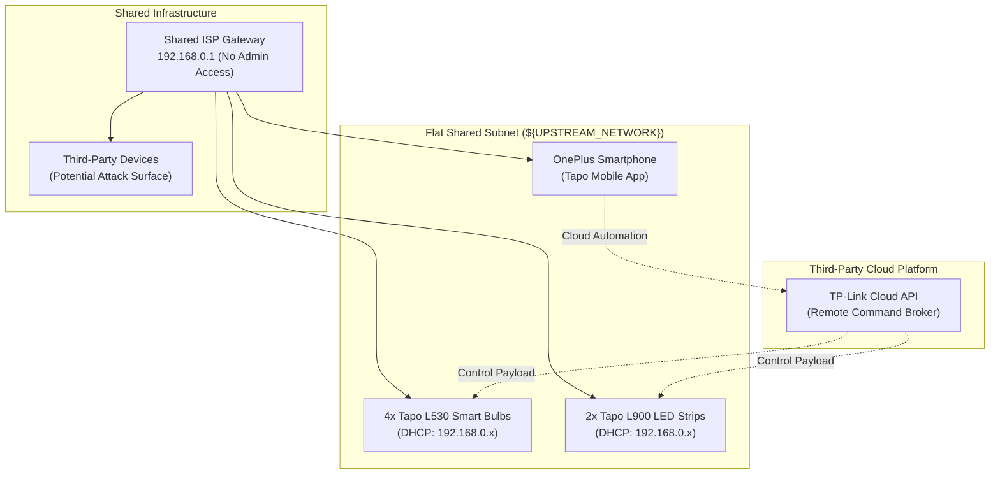

# 📦 Sprint 0: Baseline IoT Setup on Shared Unmanaged Wi-Fi

> **Status:** Completed  
> **Theme:** Consumer IoT Onboarding, Environmental Constraint Discovery & Perimeter Analysis

---

## 🎯 Context & Problem Statement

The goal was to equip the living and work area with programmable smart lighting. However, the physical deployment was constrained by an **unmanaged, shared ISP network** with no administrative access to the upstream gateway:

- **Zero Gateway Control:** Inability to create isolated SSIDs, configure static DHCP reservations, or access port-forwarding rules.
- **Untrusted Broadcast Domain:** The local Layer-2 broadcast domain was shared with third-party tenants, exposing IoT device discovery traffic to passive inspection.
- **Cloud Dependency:** Perimeter devices relied entirely on vendor cloud brokers (TP-Link Tapo cloud) for command orchestration.

---

## 🗺️ Network Topology: Before vs After

### Topology Before Sprint 0 (Baseline Environment)

### Topology After Sprint 0 (Flat IoT Broadcast Domain)

---

## 🛠️ Materials & Equipment Used

| Hardware / Peripherals | Model / Specification | Purpose |
| :--- | :--- | :--- |
| **Smart Bulbs** | 4x TP-Link Tapo L530 (E27, Multicolor) | Primary desk and ambient lighting |
| **LED Light Strips** | 2x TP-Link Tapo L900 (5m Addressable Wi-Fi) | Desk backlight and perimeter ambient accents |
| **Mobile Control Node** | OnePlus (CPH2465) / Android 14 | Initial Bluetooth onboarding & Tapo app provisioning |
| **Upstream Gateway** | Shared ISP Wireless Gateway (802.11n/ac) | Shared unmanaged uplink (192.168.0.1) |

---

## ⚙️ Technical Implementation & Achievements

1. **Hardware Commissioning:**
   - Assembled and mounted 4x Tapo L530 bulbs into desk and overhead fixtures.
   - Positioned 2x Tapo L900 strips along work surfaces for synchronized backlighting.
2. **Peripheral Onboarding:**
   - Commissioned each smart device onto the 2.4 GHz shared Wi-Fi network using BLE pairing in the TP-Link Tapo companion application.
3. **Basic Automation Routines:**
   - Configured basic wake-up and sleep schedules via the vendor mobile app.
   - Tested color temperature and brightness transitions for productivity cycles.

---

## ⚠️ Challenges & Technical Limitations Identified

* **L2 Broadcast Exposure:** Wi-Fi devices used unencrypted multicast discovery (mDNS / SSDP) over a flat network shared with unknown external users.
* **High Latency & Vendor Lock-in:** Light switching suffered high round-trip latency (150ms to 400ms) because commands traveled out to TP-Link cloud servers before returning to the local lamp.
* **Loss of Control During Outages:** Any ISP upstream dropout rendered local lighting completely uncontrollable via software.