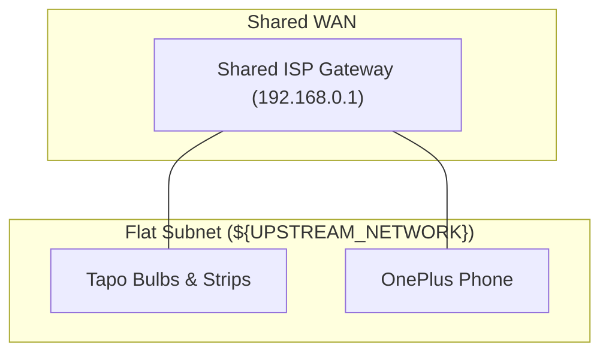
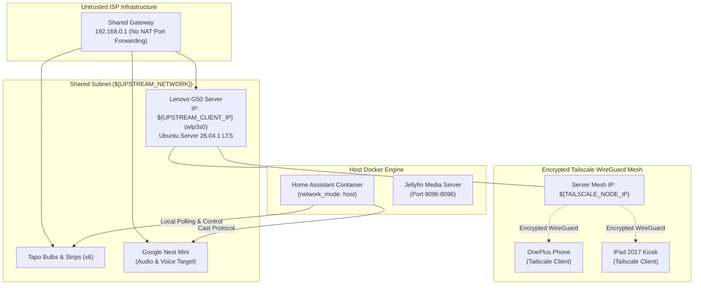

# 📦 Sprint 1: Server Core Provisioning, Remote Mesh & Smart Display

> **Status:** Completed  
> **Theme:** Hardware Salvage, Storage Tiering, WireGuard Mesh & Kiosk Dashboard

---

## 🎯 Context & Problem Statement

Building on Sprint 0, the objective was to eliminate dependency on third-party cloud brokers by creating a self-hosted central orchestrator. Because the upstream ISP gateway blocked all port forwarding and inbound routing, remote administrative access required an alternative encrypted mesh architecture:

- **Hardware Recycling:** Repurposing an aging Lenovo G50 laptop for continuous 24/7 headless server duties.
- **Bypassing Inbound NAT Restrictions:** Establishing encrypted remote access from outside the network without router configuration.
- **Storage Tiering:** Separating system runtimes from bulk multimedia storage across separate physical drives.
- **Interactive Control Surface:** Repurposing an iPad 2017 as a wall/desk kiosk display running Home Assistant.

---

## 🗺️ Network Topology: Before vs After

### Topology Before Sprint 1 (Sprint 0 Flat Baseline)


### Topology After Sprint 1 (Centralized Server & Tailscale Mesh)


---

## 🛠️ Materials & Equipment Used

| Hardware / Peripherals | Model / Specification | Purpose |
| :--- | :--- | :--- |
| **Central Server** | Lenovo G50-80 (Intel Core i3-5005U / HD 5500, AMD Radeon R5, 12GB DDR3) | 24/7 Compute host and container engine |
| **Primary System Drive** | 256GB 2.5" SATA SSD | Root filesystem (`/`), Docker volumes, SQLite databases |
| **Secondary Mass Storage** | 800GB 2.5" 5400RPM HDD | Formatted `ext4`, mounted at `/mnt/data` for Jellyfin |
| **Dashboard Controller** | Apple iPad (5th Gen, 2017) running iOS 16 | Lovelace Mushroom UI dashboard in Guided Access mode |
| **Smart Voice Node** | Google Nest Mini | Network audio and TTS notifications |
| **Operating System** | Ubuntu Server 26.04.1 LTS (Kernel 7.0 OEM) | Base Linux server platform |

---

## ⚙️ Technical Implementation & Achievements

### 1. Storage Architecture & 24/7 Power Management
- **Storage Tiering:** System root partitioned onto the 256GB SSD. The secondary 800GB drive was formatted with `ext4` and persistently mounted via UUID in `/etc/fstab`:
  ```text
  UUID=xxxxxxxx-xxxx-xxxx-xxxx-xxxxxxxxxxxx /mnt/data ext4 defaults,nofail 0 2
  ```
- **ACPI Lid Behavior:** Configured `/etc/systemd/logind.conf` to ignore lid-close events:
  ```ini
  [Login]
  HandleLidSwitch=ignore
  HandleLidSwitchExternalPower=ignore
  ```
  Applied via `systemctl restart systemd-logind`.

### 2. Tailscale WireGuard Mesh Tunneling
- Deployed Tailscale client on the host (`${TAILSCALE_NODE_IP}`), OnePlus, and iPad.
- Enabled zero-trust direct routing without router port forwarding or public static IP assignment.

### 3. Docker Core Deployment
Configured `~/serveur/docker-compose.yml`:
```yaml
services:
  homeassistant:
    container_name: homeassistant
    image: ghcr.io/home-assistant/home-assistant:stable
    volumes:
      - ~/serveur/homeassistant:/config
      - /etc/localtime:/etc/localtime:ro
    restart: unless-stopped
    network_mode: host
    privileged: true

  jellyfin:
    container_name: jellyfin
    image: jellyfin/jellyfin:latest
    volumes:
      - ~/serveur/jellyfin/config:/config
      - ~/serveur/jellyfin/cache:/cache
      - /mnt/data/medias:/media
    restart: unless-stopped
    ports:
      - "8096:8096"
```

### 4. Interactive iPad Lovelace Dashboard & Dual-Ack Alarm Logic
- Configured Lovelace with custom Mushroom cards, weather forecasting, and Google Calendar sync.
- Locked the interface using **iOS Guided Access** with single-app pinning.
- Programmed a multi-device wake-up state machine requiring physical confirmation on both the Google Nest Mini and a mobile device before dismissing the alarm.

---

## ⚠️ Challenges & Technical Limitations Encountered

1. **ACPI Deep Sleep on Lid Closure:**
   * *Issue:* Closing the laptop lid initially forced the machine into ACPI S3 suspend, dropping network sockets.
   * *Resolution:* Reconfigured `systemd-logind` to ignore lid switches while connected to AC power.
2. **Containerized Network Discovery:**
   * *Issue:* Tapo bulbs and the Google Nest Mini could not be detected when Home Assistant ran inside standard isolated bridge networks.
   * *Resolution:* Applied `network_mode: host` to allow Home Assistant direct access to Layer-2 broadcast interfaces for mDNS/SSDP discovery.
3. **Internal Wi-Fi Instabilities:**
   * *Issue:* The laptop's internal Broadcom/Realtek Wi-Fi (`wlp3s0`) suffered intermittent packet drops and latency spikes during sustained operations.