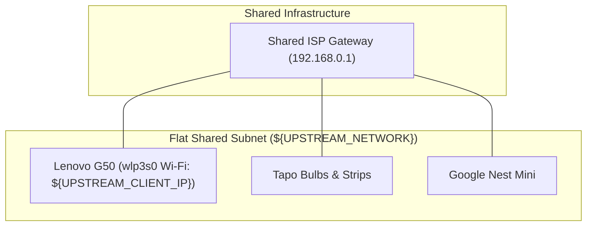
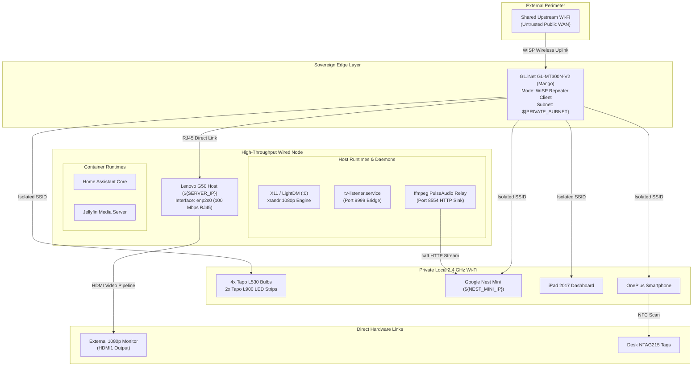

# 📦 Sprint 2: Network Sovereignty, Kiosk Display & Physical NFC Controls

> **Status:** Completed  
> **Theme:** OpenWrt Edge Routing, Wired Host Migration, HDMI Kiosk & Audio Loopback

---

## 🎯 Context & Problem Statement

Sprint 1 successfully established server services, but left the system tethered to an unstable, shared wireless broadcast domain. Sprint 2 was designed to achieve **network sovereignty** and add physical input/output capabilities:

- **Network Sovereignty:** Decoupling the lab from the shared network using an OpenWrt router in WISP repeater mode.
- **Wired Server Stability:** Eliminating Wi-Fi latency on the Lenovo G50 by migrating to a static RJ45 connection.
- **Physical Kiosk Display:** Transforming the headless server into a multimedia kiosk displaying live video on an external monitor.
- **Audio Redirection:** Rerouting host audio output to the Google Nest Mini across the network.
- **Physical NFC Presence:** Integrating desk-mounted NFC tags to trigger automated workflows.

---

## 🗺️ Network Topology: Before vs After

### Topology Before Sprint 2 (Sprint 1 Topology)


### Topology After Sprint 2 (Isolated Subnet & Physical Kiosk)


---

## 🛠️ Materials & Equipment Used

| Hardware / Peripherals | Model / Specification | Purpose |
| :--- | :--- | :--- |
| **Edge Router** | GL.iNet GL-MT300N-V2 ("Mango") running OpenWrt | WISP Wi-Fi repeater & private DHCP gateway (`192.168.8.1`) |
| **Ethernet Interconnect** | Cat5e Flat RJ45 Patch Cable | Dedicated wired link between Mango LAN and Lenovo G50 |
| **Video Display Sink** | External Portable 1080p Monitor | Direct HDMI video output sink (1920x1080 @ 60Hz) |
| **Video Interconnect** | Standard HDMI to HDMI Cable | Carries native video from Lenovo HDMI port to portable monitor |
| **Physical Automation** | 10x NTAG215 Circular NFC Stickers | Desk-mounted physical triggers for room automation |
| **Audio Output Node** | Google Nest Mini (`${NEST_MINI_IP}`) | Network speaker for TV audio loopback and speech |

---

## ⚙️ Technical Implementation & Achievements

### 1. Edge Router Setup & Wired Migration
- **WISP Repeater:** Configured GL.iNet Mango to join the shared upstream Wi-Fi as a client and broadcast a private local subnet (`${PRIVATE_SUBNET}`).
- **Ethernet Binding:** Connected the Lenovo G50 to the Mango LAN port. Assigned static IP `${SERVER_IP}` on `enp2s0` and disabled the internal Wi-Fi adapter (`wlp3s0`).

### 2. X11 Kiosk Orchestration (`/usr/local/bin/tv_arte.sh`)
Built a host script to manage DPMS power states, screen layout via `xrandr`, and browser kiosk execution:
```bash
#!/bin/bash
export DISPLAY=:0
export XAUTHORITY=/var/run/lightdm/root/:0

case "$1" in
  ouvrir)
    if ! pgrep -x "Xorg" > /dev/null; then
      systemctl restart lightdm
      sleep 3
    fi
    xset -display :0 dpms force on 2>/dev/null
    xrandr --output eDP1 --off --output HDMI1 --mode 1920x1080 --rate 60.00 --primary 2>/dev/null
    pkill -9 -f "chrome" 2>/dev/null
    pkill -9 -f "chromium" 2>/dev/null
    pkill -9 -f "epiphany" 2>/dev/null
    runuser -l paulux -c "DISPLAY=:0 chromium-browser --no-first-run --disable-session-crashed-bubble --autoplay-policy=no-user-gesture-required --kiosk 'https://www.arte.tv/fr/direct/' &"
    /usr/local/bin/stream_to_nest.sh start
    ;;
  fermer)
    /usr/local/bin/stream_to_nest.sh stop
    pkill -9 -f "chrome" 2>/dev/null
    pkill -9 -f "chromium" 2>/dev/null
    pkill -9 -f "epiphany" 2>/dev/null
    xrandr --output HDMI1 --off 2>/dev/null
    xset -display :0 dpms force off 2>/dev/null
    ;;
esac
```

### 3. Docker-to-Host RPC Bridge (`/etc/systemd/system/tv-listener.service`)
To allow containerized Home Assistant to execute display commands on the host, a persistent listener was deployed on port 9999:
```ini
[Unit]
Description=TV Display and Audio Command Listener
After=network.target sound.target

[Service]
Type=simple
ExecStart=/bin/sh -c 'while true; do { echo -ne "HTTP/1.1 200 OK\r\nContent-Length: 2\r\n\r\nOK"; } | ncat -l -p 9999 -c "xargs -n1 /bin/sh -c '\''case \$$0 in *ouvrir*) /usr/local/bin/tv_arte.sh ouvrir;; *fermer*) /usr/local/bin/tv_arte.sh fermer;; esac'\''"; done'
Restart=always
RestartSec=3

[Install]
WantedBy=multi-user.target
```

### 4. Audio Redirection via PulseAudio Monitor (`/usr/local/bin/stream_to_nest.sh`)
Taps the host's PulseAudio monitor sink, transcodes the audio to an MP3 stream on port 8554, and instructs the Google Nest Mini to play the stream using `catt`:
```bash
#!/bin/bash
DEVICE_NAME="Chambre principale"

case "$1" in
  start)
    pkill -f "ffmpeg.*8554" 2>/dev/null
    catt -d "$DEVICE_NAME" stop 2>/dev/null
    runuser -l paulux -c "export XDG_RUNTIME_DIR=/run/user/1000; ffmpeg -f pulse -i default.monitor -acodec libmp3lame -ab 128k -f mp3 -listen 1 http://0.0.0.0:8554/stream.mp3 &"
    sleep 1
    catt -d "$DEVICE_NAME" cast "http://${SERVER_IP}:8554/stream.mp3" &
    ;;
  stop)
    catt -d "$DEVICE_NAME" stop 2>/dev/null
    pkill -9 -f "ffmpeg.*8554" 2>/dev/null
    ;;
esac
```

---

## ⚠️ Challenges & Technical Limitations Encountered

1. **DisplayLink & USB-C Alt-Mode Failure:**
   * *Issue:* The portable monitor was initially connected via a USB-C to USB-A cable using the DisplayLink EVDI driver. `lsusb` showed only internal peripherals, and `xrandr` reported `VIRTUAL1 disconnected`. The monitor required raw DisplayPort Alt-Mode signals that standard USB-A 3.0 ports cannot supply without an internal hardware decoder.
   * *Resolution:* Switched to a dedicated HDMI-to-HDMI connection on `HDMI1`, bypassing DisplayLink entirely and unlocking native hardware acceleration.
2. **Ethernet Interface DHCP Delay:**
   * *Issue:* Plugging the RJ45 cable brought interface `enp2s0` UP, but it only acquired a link-local IPv6 address (`fe80::...`), failing to request an IPv4 lease from the Mango router.
   * *Resolution:* Applied netplan configuration forcing `dhcp4: true` on `enp2s0` and issued `dhclient enp2s0`, securing `${SERVER_IP}`. The unstable Wi-Fi interface (`wlp3s0`) was then shut down.
3. **Headless Audio Routing to Cast Peripherals:**
   * *Issue:* The host had no physical speakers, and Chromium running in an automated X11 session could not natively direct its audio sink to Google Cast.
   * *Resolution:* Designed the `ffmpeg` PulseAudio monitor loopback script, publishing an MP3 HTTP sink on port 8554 and using `catt` to target the Google Nest Mini.