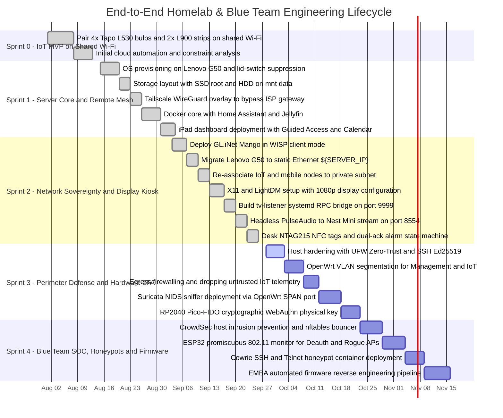
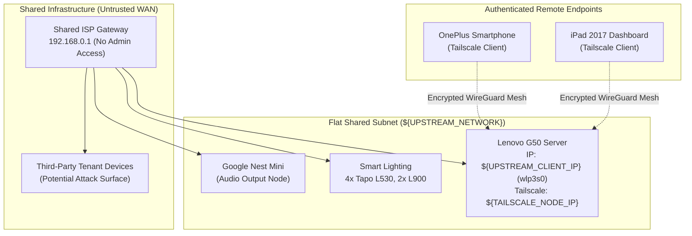
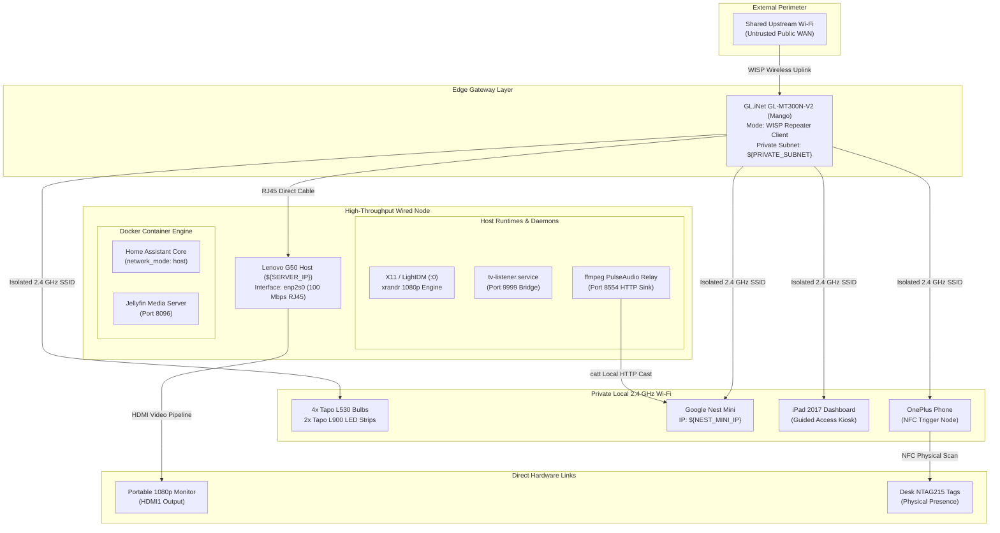
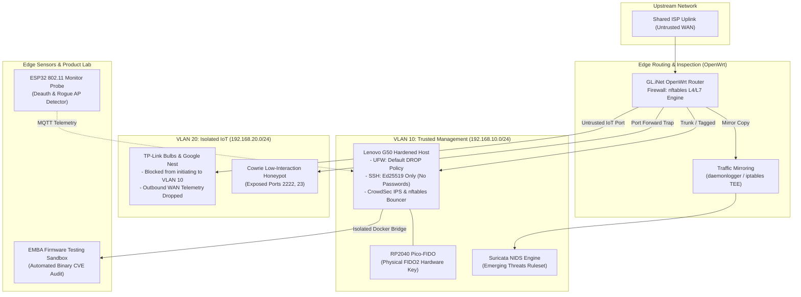

# 🎯 Homelab Engineering Roadmap: Sprints 0 to 4 (From Scavenged Hardware to Blue Team Defense)

> Comprehensive technical blueprint tracking the end-to-end evolution of the homelab: from initial consumer IoT experiments on an unmanaged network, to edge routing and display orchestration, through active Network Defense, Hardware Identity (2FA), and Product/IoT Security Engineering.

---

## 📅 Master Project Timeline (Gantt Chart)

---

## 🏗️ Evolution of Architecture & Connectivity

### Phase 1 (Sprints 0 & 1): Flat, Shared & Hostile Network
All nodes share a single unmanaged subnet with third-party tenants. Remote access relies entirely on Tailscale NAT traversal.

---

### Phase 2 (Sprint 2): Edge Routing, Local Private Subnet & Kiosk Display
The GL.iNet Mango establishes network sovereignty. The server is wired to Ethernet, IoT devices migrate to a dedicated Wi-Fi network, and display and audio pipelines are brought online.

---

### Phase 3 (Sprints 3 & 4): Hardened Defense, VLANs, NIDS & Product Security Testbed
The target architecture introduces microsegmentation, continuous traffic inspection, cryptographic hardware keys, radio sensing, and firmware analysis.

---

## 🔍 Detailed Sprint Breakdown: Past, Present & Future

### 📦 Sprint 0: Baseline IoT Setup on Shared Network
* **Status:** Completed
* **Context & Problem:** The physical space required smart lighting, but the only connectivity was a flat, shared, unmanaged Wi-Fi network without administrator rights to the upstream gateway.
* **Deliverables:**
  * Acquired and provisioned smart lighting: 4x TP-Link Tapo L530 multi-color bulbs and 2x Tapo L900 LED addressable light strips.
  * Paired all peripherals to the shared Wi-Fi using the vendor mobile app.
  * Configured basic mobile-driven cloud automations (on/off schedules).
* **Technical Takeaways & Risks Identified:**
  * **Lack of Isolation:** Smart devices operated on the exact same L2 broadcast domain as third-party network users.
  * **Cloud Reliance:** Control latency was dependent on vendor cloud endpoints; local discovery protocols broadcast unencrypted traffic across the entire building network.

---

### 📦 Sprint 1: Core Server Provisioning, Mesh Tunneling & Smart Display
* **Status:** Completed
* **Context & Problem:** Centralize smart home control into a local, self-hosted orchestrator using recycled equipment, while bypassing the strict NAT/routing restrictions of the ISP gateway.
* **Deliverables:**
  * **Hardware Salvage & OS Provisioning:** Repurposed an aging Lenovo G50 laptop (Intel Core i3 / HD 5500, 12GB DDR3 RAM). Installed Ubuntu Server 26.04.1 LTS (Kernel 7.0 OEM).
  * **Storage Architecture:** Segregated OS and container storage onto a 256GB SSD (root `/`), while formatting the secondary 800GB HDD as `ext4`, persistently mounting it at `/mnt/data` via UUID in `/etc/fstab`.
  * **24/7 Power Management:** Reconfigured systemd ACPI behavior in `/etc/systemd/logind.conf` (`HandleLidSwitch=ignore`) to ensure stable continuous operation with the laptop lid closed.
  * **Mesh Network (Tailscale):** Installed Tailscale WireGuard overlay to assign the host a dedicated mesh IP (`${TAILSCALE_NODE_IP}`), enabling encrypted remote administrative access from mobile clients without opening inbound WAN ports.
  * **Docker Core Stack:** Deployed Docker and Docker Compose running Home Assistant Container (`network_mode: host` for local discovery) and Jellyfin media server (`8096:8096`).
  * **Interactive iPad Dashboard:** Deployed an Apple iPad (2017) using iOS Guided Access as a dedicated wall/desk controller running Home Assistant with custom Lovelace Mushroom UI, Google Calendar integration, and live environmental controls.
  * **Multi-Device Alarm Logic:** Designed an alarm routine in Home Assistant featuring a multi-factor acknowledgment gate requiring confirmation on both the Google Nest Mini and mobile device before stopping.

---

### 📦 Sprint 2: Network Sovereignty, Kiosk Display & Physical NFC
* **Status:** Completed
* **Context & Problem:** Eliminate Wi-Fi unreliability on the host laptop, break free from the shared broadcast domain, and implement a hybrid headless server and video output kiosk.
* **Deliverables:**
  * **Edge Gateway Deployment:** Deployed a GL.iNet GL-MT300N-V2 ("Mango") pocket router running OpenWrt in WISP client repeater mode, establishing an autonomous private subnet (`${PRIVATE_SUBNET}`).
  * **Physical Interface Migration:** Connected the Lenovo G50 directly to the Mango's LAN port via RJ45 Ethernet (`enp2s0`), securing a static IP reservation at `${SERVER_IP}` and permanently disabling the unstable internal Wi-Fi adapter (`wlp3s0`).
  * **Perimeter Re-Association:** Reconnected the smart lighting, iPad, OnePlus, and Google Nest Mini (`${NEST_MINI_IP}`) to the private SSID.
  * **Host Kiosk Plumbing:** Configured X11 and LightDM on display `:0`, outputting 1080p @ 60Hz over HDMI to an external portable monitor via `/usr/local/bin/tv_arte.sh`.
  * **Docker-to-Host RPC Bridge:** Built `tv-listener.service`, a lightweight systemd service executing an `ncat` loop on port `9999` to translate Home Assistant `curl` commands into host display and browser operations.
  * **Headless Audio Loopback:** Created `/usr/local/bin/stream_to_nest.sh` using PulseAudio default monitor capture and `ffmpeg` transcoding, streaming live TV audio directly to the Google Nest Mini via HTTP on port `8554` using `catt`.
  * **Physical NFC Controls:** Positioned desk-mounted NTAG215 NFC tags to trigger lighting, wake-up routines, and video streaming via device scans.

---

### 🛡️ Sprint 3: Perimeter Defense, Network Isolation & Physical 2FA
* **Status:** In Progress
* **Focus Areas:** Network Security, Zero-Trust Architecture, Cryptographic Access Control  
* **Target Hardware:** Lenovo G50, GL.iNet Mango (OpenWrt), Raspberry Pi Pico (RP2040)
* **Technical Deliverables:**
  1. **Host Hardening (Zero-Trust Local Baseline):**
     * Restrict UFW incoming policy to `DEFAULT DROP`. Allow inbound management traffic strictly over `tailscale0` and designated local interfaces.
     * Enforce public-key authentication strictly using `ed25519` keypairs. Disable password authentication (`PasswordAuthentication no`) and root logins over SSH (`PermitRootLogin no`).
     * Transition Docker containers away from `network_mode: host` where mDNS broadcast is unnecessary, binding them to isolated internal Docker bridges with restricted subnet egress.
  2. **Perimeter Isolation & Network Segmentation (OpenWrt):**
     * Configure **VLAN 10 (`Management/Trusted`)** for the Lenovo G50, iPad, and administrative interfaces.
     * Configure **VLAN 20 (`IoT/Untrusted`)** for TP-Link lighting and Google Nest Mini.
     * Enforce strict `nftables` inter-VLAN forwarding policies: allow established/related traffic from VLAN 20 to VLAN 10, but drop any newly initiated connections from VLAN 20 into VLAN 10.
     * Drop unauthorized outbound IoT telemetry destined for external third-party cloud hosts.
  3. **Passive Network Intrusion Detection (Suricata NIDS):**
     * Implement port mirroring on the OpenWrt gateway (`daemonlogger` or `iptables TEE`) to mirror LAN packets to a dedicated monitoring interface on the Lenovo server.
     * Deploy Suricata with the Emerging Threats (ET-Open) ruleset to monitor port scans, brute-force behavior, and anomalous payloads in `/var/log/suricata/eve.json`.
  4. **Physical Identity & Hardware Token (Pico-FIDO):**
     * Flash an RP2040 microcontroller with the **Pico-FIDO** firmware, turning the board into a physical FIDO2/WebAuthn security key.
     * Enforce the physical key as the second factor for administrative access (Home Assistant, GitHub Git commit signing, and local management).
     * Pair physical presence validation with desk-mounted NTAG215 NFC tags to authorize administrative maintenance states.

---

### 🔍 Sprint 4: Blue Team Operations, SOC & Product/IoT Security
* **Status:** Upcoming
* **Focus Areas:** Host Intrusion Prevention, Radio Defense, Embedded Firmware Reverse Engineering, Deception  
* **Target Hardware:** ESP32-WROOM-32 (USB-C), Docker Sandbox, Firmware Binaries
* **Technical Deliverables:**
  1. **Host Intrusion Prevention & Dynamic Remediation (CrowdSec):**
     * Deploy CrowdSec to parse systemd journals, `/var/log/auth.log`, and reverse proxy logs.
     * Deploy the CrowdSec `nftables` bouncer to inject kernel-level drop rules upon detecting suspicious brute-force or HTTP fuzzing patterns.
     * Forward security alerts directly to the Home Assistant notification center.
  2. **802.11 Radio Defense Probe (ESP32 Sensor):**
     * Flash an ESP32 in promiscuous monitor mode to inspect 802.11 management frames across local Wi-Fi channels.
     * Program detection logic for deauthentication floods and Rogue AP / Evil Twin beacons broadcasting mismatched BSSIDs.
     * Forward attack alerts over MQTT to Home Assistant (`homeassistant/security/radio_alert`) to trigger automated visual warnings (lighting set to red) and mobile push notifications.
  3. **Deception Engineering (Cowrie IoT Honeypot):**
     * Deploy an isolated Cowrie container exposing simulated SSH (port `2222` port-forwarded) and Telnet (port `23`).
     * Collect automated brute-force credentials, malicious scripts, and dropped Mirai/Gafgyt binary payloads for threat intelligence analysis.
  4. **Product Security & Automated Firmware Auditing (EMBA):**
     * Deploy **EMBA** (Embedded Linux Firmware Analysis Engine) in an isolated containerized environment.
     * Extract and audit public firmware images from consumer routers and IoT devices.
     * Inspect binary protections (ASLR, NX, PIE, Stack Canaries), extract hardcoded cryptographic keys, and identify unpatched embedded CVEs to produce structured vulnerability audit reports.

---

## 💼 Skills & Portfolio Value Matrix for Hiring Teams

| Engineering Domain | Enterprise Equivalent Role | Artifact Shown in Repository |
| :--- | :--- | :--- |
| **Network Segmentation & Microsegmentation** | Network Security Specialist / Firewall Admin | OpenWrt `network.uci`, `firewall.uci`, VLAN routing policies, zero-trust traffic matrix. |
| **Network Intrusion Detection (NIDS)** | SOC Analyst / Detection Engineer | Suricata configuration, ET-Open signature tuning, Eve JSON log parsing pipelines. |
| **Host Hardening & Identity (IAM)** | Infrastructure Security Engineer | UFW default-drop baseline, Ed25519 SSH policies, RP2040 FIDO2 hardware token integration. |
| **Edge & Radio Threat Monitoring** | Physical Blue Team / IoT Security Engineer | ESP32 C++ monitor firmware, MQTT incident alert automation pipeline. |
| **Firmware Reverse Engineering** | Product Security / Embedded Pen-Tester | EMBA automated firmware vulnerability audit reports and mitigation strategies. |
